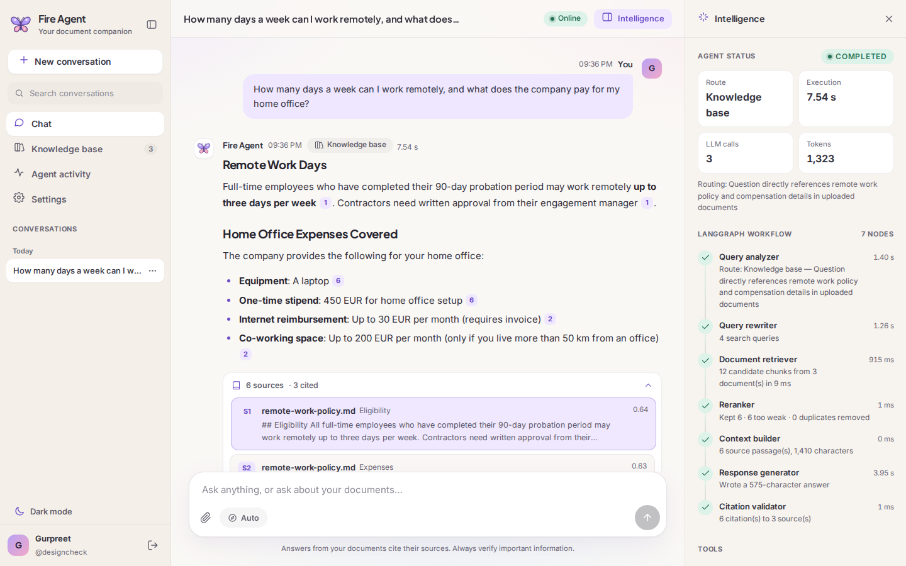
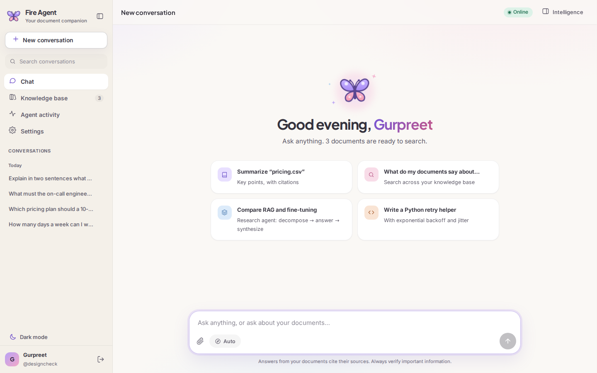
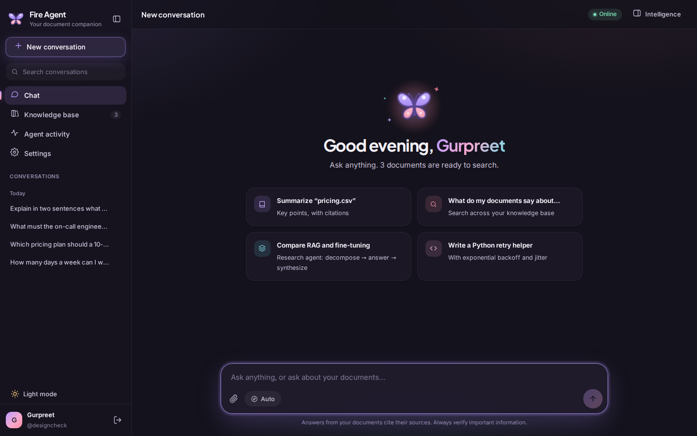
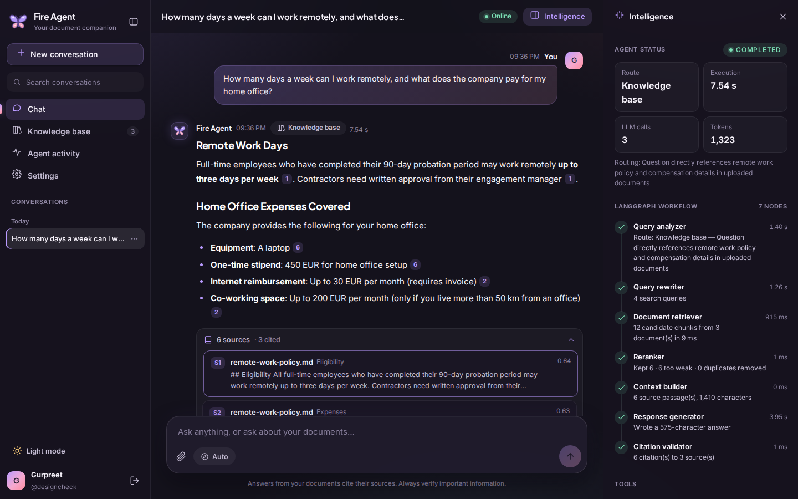
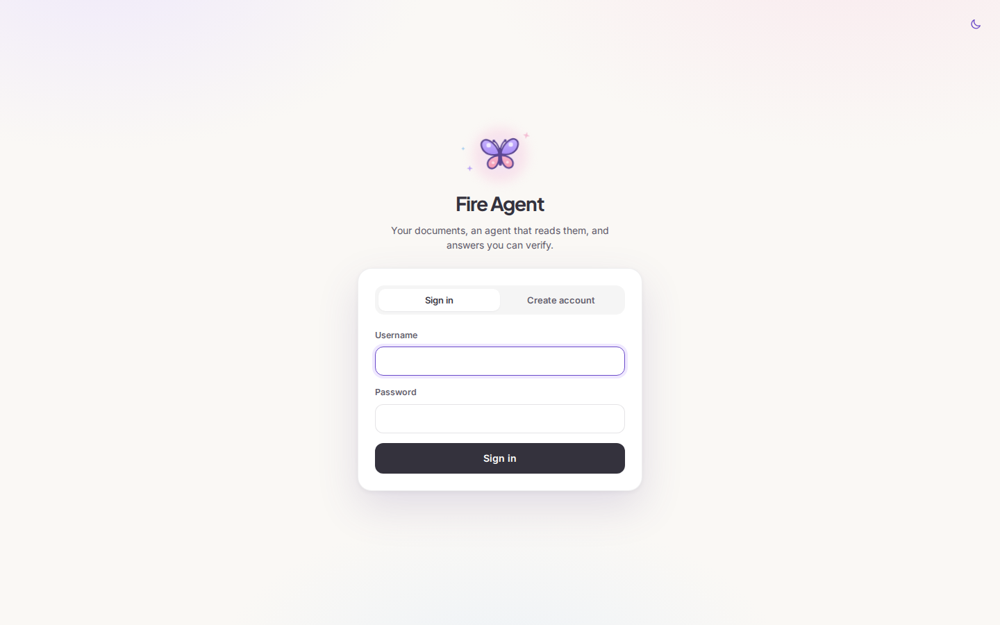
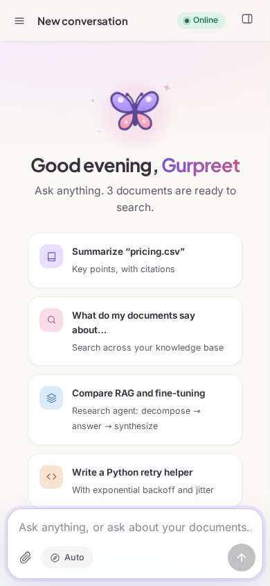
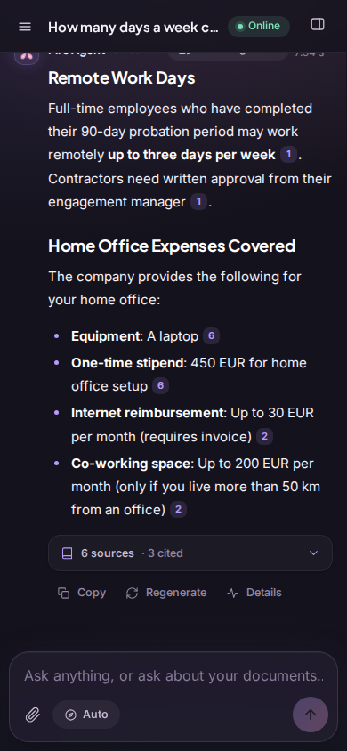
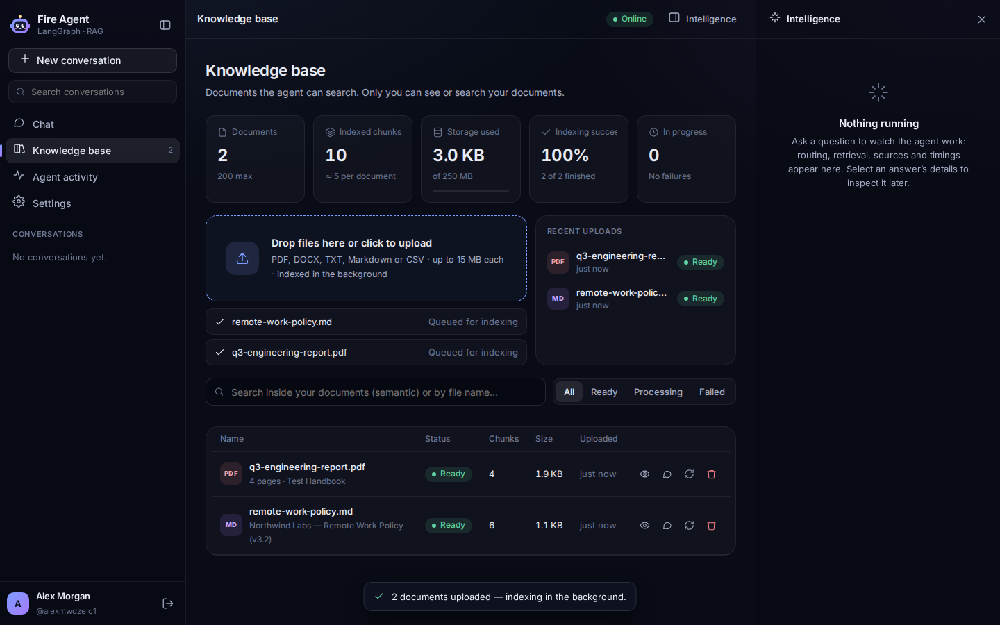
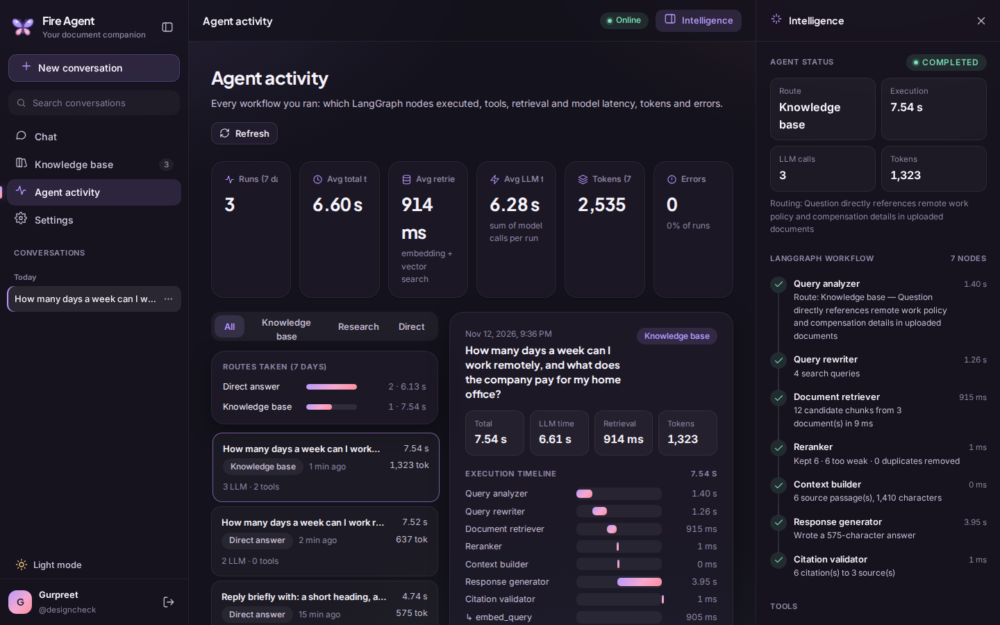

# Fire Agent — LangGraph + RAG

**Live site: https://agent.papillon.website** (sign-up needs an invite code)

A document-aware AI assistant. Upload PDFs, Word files, Markdown, text or CSV; ask questions in a streaming chat; get
answers that cite the exact passages they came from, or a clear "your documents don't contain this". Under the hood a
LangGraph agent routes each question to retrieval-augmented generation, to a multi-agent research pipeline, or to a
direct answer, and every run is traced and automatically evaluated.

All model calls go through **Fire** (`/v1/chat`, `/v1/chat/stream`, `/v1/embed`); vectors live in **PostgreSQL + pgvector**.



### Light and dark themes

A soft pastel light theme (the default) and a midnight-plum dark theme, switchable from the sidebar and remembered per browser.

| Light | Dark |
|---|---|
|  |  |
|  |  |

| Sign in | Phone (light) | Phone (dark) |
|---|---|---|
|  |  |  |

## What's inside

- **Routed LangGraph agent**: Query Analyzer → (Query Rewriter → Retriever → Reranker → Context Builder → Response
  Generator → Citation Validator) | (Decomposer → Research agent → Synthesizer, the original pipeline) | Direct answer.
  Conditional edges, conversation-aware query rewriting, graceful degradation on errors. → [docs/architecture.md](docs/architecture.md)
- **Complete RAG pipeline**: validation + content sniffing, extraction with page/heading/row provenance, cleaning,
  boundary-aware chunking with overlap, Fire embeddings with retries, pgvector storage, user-scoped exact search, hybrid
  reranking (cosine + IDF term overlap), threshold + relative cutoff, de-duplication, context budgeting, citation validation.
- **App**: accounts (invite-gated sign-up), persistent searchable conversations, streaming Markdown with highlighted code,
  inline citation chips that open the cited passage, copy / regenerate / stop, file attachments scoped to the next question,
  a live **Intelligence panel** (route, LangGraph nodes, tools, retrieval stats, sources, timings), a **Knowledge base**
  dashboard (drag-and-drop upload, live indexing status, semantic search, previews, re-index, delete, real statistics),
  **Agent activity** (execution timelines, model and tool latency, tokens, errors) and **Settings**.
- **AI Evaluation Center** (admin, from the original project): LLM-judge faithfulness, relevance, groundedness, citation
  accuracy, tool accuracy, hallucination and safety for every request, trends, regression suites → [docs/evaluation.md](docs/evaluation.md).

| Knowledge base | Agent activity |
|---|---|
|  |  |

## Install

```bash
python3 -m venv .venv && .venv/bin/pip install -r requirements-dev.txt
cp .env.example .env   # set FIRE_API_KEY, EVAL_ADMIN_TOKEN; for production also AGENT_ACCESS_TOKEN, DATABASE_URL, COOKIE_SECURE=true
```

**Database.** Without `DATABASE_URL` the app uses SQLite (`data/evaluation.db`) and searches vectors in Python, which is
fine for development. For production use PostgreSQL with pgvector:

```sql
CREATE ROLE agent LOGIN;  CREATE DATABASE agent OWNER agent;
\c agent
CREATE EXTENSION vector;          -- as a superuser, once
```

```bash
DATABASE_URL=postgresql+psycopg://agent@/agent?host=/var/run/postgresql   # in .env
```

## Migrations

Migrations run automatically at startup (`EVAL_AUTO_MIGRATE=true`). To run them by hand:

```bash
.venv/bin/alembic upgrade head          # uses DATABASE_URL
```

`0001` creates the evaluation tables; `0002` adds users, sessions, conversations, messages, documents, chunks
(`vector(1536)` on PostgreSQL) and the trace route/timeline columns. Moving an existing SQLite install to PostgreSQL:

```bash
.venv/bin/python scripts/copy_sqlite_to_postgres.py sqlite:///data/evaluation.db "$DATABASE_URL"   # idempotent, re-runnable
```

## Start

```bash
.venv/bin/uvicorn app.main:app --port 8000
```

Open http://localhost:8000 in your browser (the live version runs at **https://agent.papillon.website**), create an account (enter the invite code if `AGENT_ACCESS_TOKEN` is set), upload documents
under **Knowledge base**, and ask away. Indexing runs in the background inside the API process.

## Environment variables

All documented in [.env.example](.env.example). The important ones:

| Variable | Default | Purpose |
|---|---|---|
| `FIRE_API_KEY` | — | Fire key (server-side only, never sent to the browser) |
| `DATABASE_URL` | SQLite | App database (PostgreSQL + pgvector in production) |
| `AGENT_ACCESS_TOKEN` | unset | Invite code required to create an account |
| `COOKIE_SECURE` | false | Set `true` behind HTTPS |
| `EVAL_ADMIN_TOKEN` | — | Opens the admin Evaluation Center |
| `RAG_CHUNK_SIZE` / `RAG_CHUNK_OVERLAP` | 1200 / 200 | Chunking (characters) |
| `EMBEDDING_MODEL` / `EMBEDDING_DIMENSIONS` | text-embedding-3-small / 1536 | Fire embedding model (dimension fixed by migration 0002) |
| `RAG_TOP_K` / `RAG_CANDIDATE_K` | 6 / 24 | Passages given to the generator / fetched per query |
| `RAG_SIMILARITY_THRESHOLD` / `RAG_RELATIVE_CUTOFF` | 0.30 / 0.75 | Minimum cosine; drop passages below 75% of the best |
| `RAG_CONTEXT_CHARS` | 12000 | Context budget |
| `MAX_UPLOAD_MB`, `MAX_DOCUMENTS_PER_USER`, `MAX_STORAGE_MB_PER_USER` | 15, 200, 250 | Upload limits and quotas |
| `RATE_LIMIT_CHAT_PER_MINUTE`, `RATE_LIMIT_UPLOADS_PER_HOUR` | 12, 60 | Per-user rate limits |

## Tests

```bash
.venv/bin/python -m pytest      # 156 tests (2 need PostgreSQL); LLM and embeddings faked, no network
TEST_PG_URL="postgresql+psycopg://agent@/agent_test?host=..." .venv/bin/python -m pytest tests/test_pgvector.py   # real pgvector
```

Covers upload validation, extraction (real PDF/DOCX/MD/CSV/TXT built in the tests), cleaning, chunking, the Fire embedding
client (retries, ordering, dimension checks), vector storage and search, retrieval relevance, metadata filters, reranking,
context budgeting, citation validation, LangGraph routing for every branch, RAG generation with citations, the
no-context path, error handling, conversation persistence, regenerate, accounts, CSRF, rate limits, per-user isolation
of every route, activity scoping, and the original agent's unchanged protocol and evaluation pipeline.

## RAG evaluation

```bash
.venv/bin/python -m evaluation.rag_eval                 # live: real embeddings, real agent, LLM judge (calls Fire)
.venv/bin/python -m evaluation.rag_eval --offline       # deterministic retrieval smoke test, no network
```

Indexes `evaluations/rag/docs` into a throw-away database and runs `evaluations/rag/cases.json` (12 answerable questions
with ground truth across Markdown, a multi-page PDF and CSV, plus 2 unanswerable ones). Latest live run (`evaluations/rag/results/`):

| Retrieval precision | Retrieval recall | Citation correctness | Fact recall | Abstention | Faithfulness | Answer relevance | Mean / p95 latency |
|---|---|---|---|---|---|---|---|
| 63% | 100% | 100% | 100% | 100% | 100% | 82% | 4.4 s / 6.4 s |

Precision is "share of passages given to the generator that contain the ground-truth fact". The corpus is small, so a
second, loosely related passage from the same document often passes the cutoff; the generator still cites the right one.
Two evaluation-driven fixes are recorded in the history: a relative score cutoff (precision 17% → 63-73%) and contextual
chunk headers (a PDF's title page was outranking the page that answered the question).

## Deploy (single server, Apache + systemd)

Set `AGENT_ACCESS_TOKEN`, `EVAL_ADMIN_TOKEN`, `DATABASE_URL` and `COOKIE_SECURE=true` in `.env`, then
`sudo bash deploy/install.sh <hostname>`: Let's Encrypt certificate, `agent-api` systemd service (uvicorn on
127.0.0.1:8310) and an Apache HTTPS site. Request-size limits are enforced in the app itself (64 KB for API calls,
10 × `MAX_UPLOAD_MB` for an upload request), not by the proxy. Re-run it, or
`sudo systemctl restart agent-api`, to deploy changes. `docker compose up --build` also works (api + evaluation worker).

## Known limitations

- **Scanned PDFs** (images only) are rejected with a message; there is no OCR. Tables inside PDFs are extracted as text lines.
- **Exact vector search** (no ANN index) is correct and fast up to roughly 100k chunks per user; beyond that add an HNSW
  index with pgvector ≥ 0.8 iterative scans.
- **One process**: rate limits and the indexing queue live in the API process (single uvicorn worker). Several workers or
  hosts need a shared rate-limit store and a separate indexing worker.
- **Changing the embedding model or dimension** requires a migration and re-indexing every document.
- **The Fire models used don't support native tool calling**, so retrieval is a graph branch chosen by the analyzer rather
  than a tool the model calls mid-answer. Multi-hop questions that need two retrieval rounds are answered from one round.
- The background **LLM-judge evaluation runs on every chat answer** (as in the original project), roughly doubling model
  cost per question; set `EVAL_ENABLED=false` to turn it off.
- No email-based password reset (accounts are invite-only); deleting an account must be done in the database.
